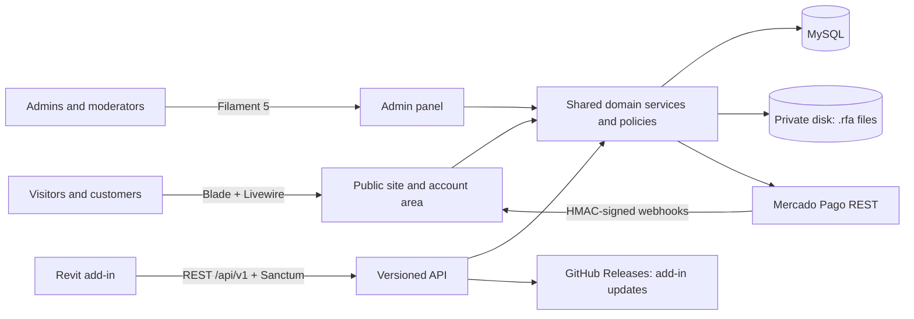

<h1 align="center">UnSet BIM</h1>

<p align="center">
  <strong>A production BIM platform for Revit families: web marketplace, subscriptions, admin panel and the REST API behind a Revit add-in.</strong>
</p>

<p align="center">
  <a href="https://unset.com.br"></a>
  
  
  
  
  
  
  
</p>

---

## Overview

**UnSet BIM** is a real, live product for architects and engineers in Brazil who work with
**Autodesk Revit**. It distributes Revit families (`.rfa` parametric components) through a
web catalog, sells them through **recurring subscriptions** and **one-off purchases**, and
exposes a versioned **REST API** so a Revit add-in can sign users in, browse the catalog and
download families straight into the model.

It is designed as a **BIM engineering platform**, not just a file store: the domain model
already separates *modules* (Architectural, Structural) so templates, spreadsheets,
calculation tools and courses can be added without reshaping the core.

> The user interface is in Brazilian Portuguese (the product's market).
> All code, comments, tests and documentation are in English.

## Why it is interesting

| | |
|---|---|
| **Real product, real constraints** | Live payments, real users, real spam bots, and **shared hosting** (no SSH, no queue workers, no reliable cron). Every design decision had to work there. |
| **One rule, every channel** | The site, the admin panel and the API share the same domain services and policies: a download is authorized, counted and recorded in exactly one place. |
| **Desktop client done right** | Token auth per device, a browser sign-in based on the **OAuth 2.0 Device Authorization Grant (RFC 8628)**, an update channel backed by GitHub Releases, and a written API contract. |
| **Domain expertise** | Built by a civil engineer working in BIM, so the data model follows how Revit families are actually used (Revit version compatibility, parametric families, categories as engineers think of them). |
| **Tested** | 70+ Pest feature tests against MySQL covering auth, access rules, catalog, downloads, the device flow, the update check and bot protection. |

## Architecture



Controllers stay thin. Business rules live in services (`FamilyDownloadService`,
`AccessService`, `FavoriteService`, `DownloadHistoryService`, `ApiTokenService`,
`DeviceAuthorizationService`, `MercadoPagoService`, ...) and policies (`FamilyPolicy`),
which are reused by every entry point.

## Engineering challenges and decisions

### 1. A single source of truth for access
Families can be free, bought individually, or included in a plan with a **monthly quota**.
The quota counts *distinct paid families per calendar month*: free and purchased families
never use it, and downloading the same family again in the same month is free.
`FamilyPolicy::download()` returns a reason and a machine-readable code
(`access_required`, `quota_exceeded`). `FamilyDownloadService` checks it, records the
download and increments counters **in one transaction**, then streams the file from a
**private disk**. The site and the API both call it, so they can never disagree.

### 2. Authenticating a public desktop client
The Revit add-in is open source, so any "app secret" shipped inside it could be extracted.
Instead, security comes from **who** is calling, not **which program**:
- Sanctum personal access tokens, stored hashed, with expiry and a limit of 5 devices per user (re-signing on the same device replaces its token).
- Accounts deactivated in the admin panel lose API access on the next request.
- **Browser sign-in (RFC 8628):** the add-in shows a short code, the user approves it on the site while signed in (password or Google), and the add-in polls for a single-use token. Google-only accounts can use the add-in, and the password never passes through it.
- Rate limits are named per route, because unnamed Laravel throttles share one counter per IP and polling would otherwise exhaust the login limit.

### 3. Payments without an SDK
Mercado Pago is integrated through its **REST API with Laravel's HTTP client**:
recurring billing (`preapproval`) for plans, Checkout Pro for one-off purchases,
**HMAC-SHA256 webhook signature validation**, and idempotent synchronization services.
A production-only float serialization issue on shared hosting (`serialize_precision`)
was diagnosed and fixed in the client.

### 4. Shared hosting as a hard constraint
- No scheduler can be trusted, so maintenance is **opportunistic**: expired device requests and abandoned unverified sign-ups are pruned during normal requests, in small batches.
- The add-in update check reads the latest **GitHub Release**, caches it, backs off after failures and keeps serving the last good answer if GitHub is down. Publishing a release is the whole deployment step.
- `.rfa` files never live under the public web root.

### 5. Layered bot protection
After real spam sign-ups appeared in production, every public form that sends e-mail
got the same protection: a strict name rule (letters of any alphabet only), strict RFC e-mail
validation with MX lookup and spoofing checks, a disposable-domain blocklist (public list
plus a project list, subdomains included), a honeypot that answers bots with a fake success,
an encrypted time trap, Cloudflare Turnstile, and the automatic pruning of accounts that
never verify.

### 6. SEO without giving up interactivity
Every listing state lives in the URL (filters in the query string), so any page or filtered
search can be shared and indexed. Category, subcategory, brand and family pages ship
breadcrumbs, structured data (JSON-LD) and a generated sitemap.

### 7. Privacy by design (LGPD)
Sign-up asks only for name, e-mail and password (or Google). Tax ID (CPF) and phone are
requested only at the first checkout. CPF is stored **encrypted**, with a separate hash for
lookups. Acceptance of the terms is versioned. Account deletion has a **30-day grace period**,
after which the account is deleted, or anonymized when financial records must be kept.

### 8. Moderation workflow
Moderators can submit families. Once a superadmin approves or edits a submission it
becomes **locked** for the moderator. The rule lives in the policy and is enforced on every
action of the admin panel.

## Features

**Public site**
- Catalog with search, filters (category, subcategory, brand, Revit version, free or paid) and sorting, all reflected in the URL
- Family pages with images, specs, compatibility and download or purchase actions
- Plans section, checkout summary, subscriptions and one-off purchases (Mercado Pago)
- Sign-up with e-mail verification, password reset and Google sign-in (Socialite)
- Terms of Use and Privacy Policy

**User account**
- Profile, password, e-mail change confirmed by e-mail, avatar with CSS initials fallback
- Favorites, download history, subscription status, purchases
- Account closing with a grace period

**Admin panel (Filament 5)**
- Families with cover and `.rfa` uploads, tags and the approval workflow
- Categories, subcategories, brands, plans, users and login history
- Read-only subscriptions, payments, purchases and pending deletions
- Dashboard widgets: revenue, subscribers by plan, downloads, visits, top families, pending reviews

**REST API (`/api/v1`)**

| Area | Endpoints |
|---|---|
| Auth | `POST /auth/login`, `POST /auth/device`, `POST /auth/device/token`, `GET /auth/me`, `POST /auth/logout` |
| Catalog | `GET /categories`, `GET /brands`, `GET /families`, `GET /families/{slug}` |
| Downloads | `GET /families/{slug}/download` |
| User lists | `GET /me/favorites`, `POST`/`DELETE /families/{slug}/favorite`, `GET /me/downloads` |
| Add-in | `GET /plugin/latest` |

The full contract (parameters, responses, error codes, rate limits and the recommended
client flow) is in **[`docs/api.md`](docs/api.md)**.

## Tech stack

| Layer | Technology |
|---|---|
| Backend | PHP 8.3, Laravel 13 |
| Admin | Filament 5 |
| Front end | Blade, Livewire 4, Tailwind CSS 4, Vite |
| Auth | Laravel Sanctum, Socialite (Google), RFC 8628 device flow |
| Payments | Mercado Pago REST API (subscriptions and Checkout Pro) |
| Images | Intervention Image |
| Database | MySQL 8 (InnoDB) |
| Tests | Pest 4 (feature tests against MySQL) |
| Security | Cloudflare Turnstile, disposable e-mail blocklist |

## Running locally

```bash
git clone https://github.com/ronaldoaires/unset.git
cd unset

composer install
npm install && npm run build

cp .env.example .env
php artisan key:generate
# set DB_* in .env, then:
php artisan migrate --seed
# no storage:link needed: public files are served through /media

php artisan serve
```

Optional integrations (Google, Mercado Pago, Turnstile, GitHub Releases) are configured
through the variables listed in `.env.example`. The app runs without them.

### Tests

The suite runs against a dedicated MySQL database (`unset_test`, see `phpunit.xml`):

```bash
php artisan test
```

## Project structure

```
app/
├── Filament/           Admin panel resources and dashboard widgets
├── Http/
│   ├── Controllers/
│   │   ├── Api/V1/     REST API
│   │   ├── Account/    User area
│   │   ├── Auth/       Sign-up, login, verification, device approval
│   │   └── Site/       Public site, checkout, webhooks
│   ├── Requests/       Form requests
│   └── Resources/      API resources
├── Policies/           Authorization rules shared by every channel
├── Rules/              Custom validation (CPF, person name, disposable e-mail, Turnstile)
├── Services/           Business logic
└── Support/            Small helpers (slug generator, bot trap)
docs/api.md             API contract
routes/                 One file per context: site, revit, account, auth, api
tests/Feature/          Pest feature tests
```

## Roadmap

- [x] Web platform, admin panel and payments
- [x] REST API v1 with contract documentation
- [ ] Revit add-in rewrite on top of the API (separate public repository)
- [ ] Structural module tools
- [ ] New product types: templates, spreadsheets and courses

## About the author

**Ronaldo Aires**, Civil Engineer (MBA in Construction Management, BIM specialization)
and full-stack developer, currently studying Computer Science. I build software where
engineering knowledge and code meet, and I teach development through online courses.

[LinkedIn](https://www.linkedin.com/in/ronaldoaires/) · [GitHub](https://github.com/ronaldoaires) · ceo@unset.com.br

## License

This repository is public so that the code can be read and evaluated. It is **not open
source**: all rights reserved. Please contact the author before reusing any part of it.
